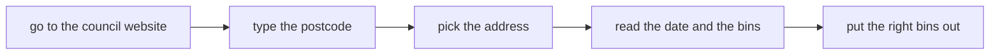

<!-- nav:top -->
[Home](../../README.md) · [Contents](../../README.md#contents) · Next: [2. Check the agent's answer automatically to enable fast iteration](../02-know-its-right/README.md)
<!-- /nav:top -->

# 1. Delegate to an agent with a skill

*"Find out for me which bins go out."*

Delegating starts with doing the job once yourself. In this chapter you'll look up the next
collection on the council's website by hand, so you know what the right answer is. Then
you'll ask a coding agent to do the same, compare its answer with yours, and save how it did
it as a skill, so that next time you can ask in one line.

## Look it up by hand

The council's website runs on your machine. Start it in a terminal, from the repo folder you
cloned at the start (`to-bin-or-not-to-bin`), and leave it running:

```bash
uv run council
```

It serves the made-up council's website at <http://localhost:8111>, showing what the council
would say today. Open it in your browser and look up the address the way you would on a real
council's website:

1. Type `FX1 2ZZ` and press **Find address**.
2. Pick **2 Wibble Way, Ollie Woley** and press **Show collections**.
3. Write down the date and which bins are due.

What you wrote down is your ground truth: you know it's right because you checked it
yourself. If today were Monday 26 October 2026, for instance, the next collection would be
the `BLACK RUBBISH WHEELIE BIN` and the `FOOD BOX` on Thursday 29 October 2026, which you can
write as an input and the outcome you expect from it:

```
f(2 Wibble Way, FX1 2ZZ, as of 26 Oct 2026)  ->  29 Oct 2026: rubbish, food
```

<details>
<summary>What "ground truth" means</summary>

Verified, real-world information gathered through direct observation and measurement, rather
than through inference, estimation or prediction.

</details>

The steps you just followed are also the instructions you'd give a friend if you asked them
to do this for you:



You don't want to burden a friend with it, so you'll give those instructions to a coding agent
instead.

## Hand it to the agent

Open a second terminal, go to the repo folder, and start Claude Code in the tutorial's
`sandbox` folder. It's empty, so the agent can't come across this tutorial and its answers
while it works:

```bash
cd steps/01-do-it-for-me/sandbox
claude
```

Then ask it the question in plain words, the way you'd ask the friend:

```text
Go to http://localhost:8111. My postcode is FX1 2ZZ and I live at 2 Wibble Way.
Which bins do I put out next, and when?
```

<details>
<summary>When Claude Code asks for permission</summary>

Claude Code asks before it runs a command, such as `curl` to fetch the council's page. Here
the commands only read from the made-up council on your machine, so it's safe to allow them.
Choose the option that allows it for the rest of the session, so it doesn't ask each time.

</details>

Watch what it does. The page fills in the addresses and the collection table with JavaScript,
so there's no answer in its HTML. The agent reads the page's JavaScript, finds the two
addresses it calls, `api/addresses` and `api/collections`, and calls them directly. When it
answers, compare its answer with what you wrote down.

## Keep it as a skill

The agent worked it out, but next time it would have to work it out again, and you'd have to
explain the site, the postcode and the address again. A skill keeps what it learned: it's a
markdown file of instructions that Claude Code loads whenever your question matches its
description. In the same session, paste:

```text
Save what you just did as a skill in .claude/skills/bin-day/SKILL.md, including my postcode
and address, so you can answer this again without me explaining it. Instructions only, no
scripts.
```

When it says the skill is saved, type `/exit`. From now on you can just ask "Do I need to put
the bins out?". That one line is enough only if the skill includes the address as well as the
steps, since the next run starts from the skill and the question you type.

<details>
<summary>Reading the skill your agent wrote</summary>

If you're curious what it came up with, it's in `sandbox/.claude/skills/bin-day/SKILL.md`:

```bash
cat .claude/skills/bin-day/SKILL.md
```


</details>

## Did the skill help?

To change something safely, you need to know whether the change made things better or
worse. Here, better could mean faster, cheaper, or both, looking at numbers such as how long a run took (`seconds`), and how much the model read and wrote (`tokens_read` and `tokens_written`), which give you a rough idea of cost.

Another type of improvement, regardless of time and money saved, is a better user experience (UX) 
by making the ask smaller and repeatable: you just write "Do I need to put the bins out?" instead of filling a larger, more detailed prompt every time.

Next you'll ask the same thing twice, to compare time and cost between the same problem with and without the skill. You're applying the scientific method in miniature: measure one situation, then the other, and see whether there's a difference. There are more thorough ways to do this, but this is enough to start with, and you can ask your coding agent to help you set up comparisons like it.

`claude -p` runs one prompt and exits, and with `--output-format json` it also reports
the model that ran, the turns, seconds, tokens and cost. From `sandbox`:

```bash
S='{answer: .result, model: (.modelUsage | keys | join(", ")), turns: .num_turns, seconds: (.duration_ms / 1000), tokens_read: (.usage.input_tokens + .usage.cache_creation_input_tokens + .usage.cache_read_input_tokens), tokens_written: .usage.output_tokens, cost_usd: .total_cost_usd}'
Q="Go to http://localhost:8111. My postcode is FX1 2ZZ and I live at 2 Wibble Way. Which bins do I put out next, and when?"

echo "== Without the skill"
claude -p "$Q" --disable-slash-commands --allowedTools "Bash(curl:*)" --output-format json | jq "$S"

echo "== With the skill"
claude -p "$Q" --allowedTools "Bash(curl:*)" Skill --output-format json | jq "$S"
```

Both runs ask exactly the same question, so the only thing that changes is whether the
agent can use the skill. `--disable-slash-commands` switches skills off for the first
run (Claude Code treats skills as slash commands), and `--allowedTools` lists what the
agent may do without asking, since a one-shot run can't stop for your approval.

<details>
<summary>What the <code>S=</code> line does</summary>

`S` holds a [jq](https://jqlang.org) filter: it picks the answer, the model, the turns, the
seconds, the tokens and the cost out of Claude Code's JSON output, and `jq "$S"` prints just
those. `Q` holds the question, so both runs ask exactly the same thing. Paste the whole block
at once.

</details>

You'll see something like this:

```
== Without the skill
{
  "answer": "Put out your **black rubbish wheelie bin** and your **food box** tomorrow, **Thursday 29 October 2026**, by 7am. The **blue recycling bin** goes out the week after, on Thursday 5 November.",
  "model": "global.anthropic.claude-opus-5-5[1m]",
  "turns": 5,
  "seconds": 19.726,
  "tokens_read": 115427,
  "tokens_written": 511,
  "cost_usd": 0.045333799999999994
}
== With the skill
{
  "answer": "Put out your **black rubbish wheelie bin** and **food box** tomorrow, **Thursday 29 October 2026**, by 7am.\n\nAfter that, your **blue recycling wheelie bin** goes out on Thursday 5 November 2026.",
  "model": "global.anthropic.claude-opus-5-5[1m]",
  "turns": 5,
  "seconds": 17.616,
  "tokens_read": 101995,
  "tokens_written": 552,
  "cost_usd": 0.0314694
}
```

Your numbers will differ with your model and setup, and they'll change over time, so
compare your two runs with each other.

You could get, for example, 12% fewer tokens read with the skill (101,995 against 115,427),
a run that finishes 11% sooner (17.6 s against 19.7 s), and a cost that's 31% lower ($0.031
against $0.045), with both runs taking 5 turns. The question is simple, so the two runs are
close. On bigger jobs, a skill can save many round trips.

<details>
<summary>Why cost can fall more than tokens read</summary>

Most input tokens come from the prompt cache. Writing to the cache costs more than normal
input, and reading from it costs much less. How much of a run hits the cache depends on what
ran just before it, so two runs of the same prompt can cost different amounts.

To compare runs fairly, use tokens read, or price every token at the uncached input rate. That
gives the most each run could have cost, which doesn't depend on the cache. A single run of
each is also noisy: run each version several times and compare the medians if you want more
robust numbers. Here, the ballpark is enough.

</details>

## It works but we want to change it

At this point we know that the solution works, that the agent figured out the site on its own, and the skill makes using it a simple one liner: "Do I need to put the bins out?", which runs the same workflow every time.

There's still a problem, though: if you forget to ask, you'll still forget to put the bins out.

From the talk: the slide [The Agent Figures It Out](https://alexhans.github.io/talks/airflow-summit/2026/it-works-now-what/#/the-agent-figures-it-out), and the [video and transcript](https://alexhans.github.io/posts/talk.it-works-now-what.html).

---

<!-- nav:bottom -->
[Home](../../README.md) · [Contents](../../README.md#contents) · Next: [2. Check the agent's answer automatically to enable fast iteration](../02-know-its-right/README.md)
<!-- /nav:bottom -->
