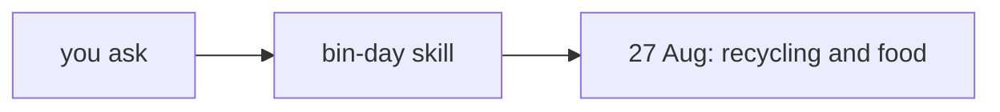
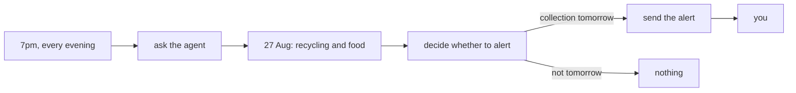

<!-- nav:top -->
[Home](../../../README.md) · [Contents](../../../README.md#contents) · Coding agent track · Previous: [2. Check the agent's answer automatically to enable fast iteration](../../../steps/02-know-its-right/README.md) · Next: [4. Reduce cost while still getting the right answer](../04-cheaper-model/README.md)
<!-- /nav:top -->

# 3. Get timely alerts without running it yourself

*"Don't make me remember to ask."*

In step 1 the agent found the right answer and you kept how it did it as a skill, and in step 2
you wrote checks that prove the answer is right. It still only runs when you ask, though, and
having to remember to ask was the problem in the first place. So this chapter moves the trigger
from you to a schedule.

Before, it started with you:



Now `cron` starts it every evening at 7pm, and you only hear from it when the bins go out tomorrow:



From the talk: the slide [From Agent Skill to Airflow Dag](https://alexhans.github.io/talks/airflow-summit/2026/it-works-now-what/#/from-agent-skill-to-airflow-dag).

## Decide what should happen

Before writing anything, decide what it should do. When you asked, you chose when to check. Now
it asks by itself every evening, so it has to decide on which evenings to tell you, and that's
new behaviour.

It asks every evening, not only before the usual collection day, so you don't need to know the
council's schedule. In New Year's week, for example, the collection moves from Thursday to
Saturday, and the alert still comes the night before.

Here's what should happen on each day, with the check that tests it. The two checks from step 2
stay as they were, because the agent still has to read the next collection date and the bins
correctly; the other three are new:

| Day | What should happen | Check | |
|---|---|---|---|
| 22 August, an ordinary week | it reads 27 August, recycling and food | `test_the_step_2_checks_still_pass[ordinary week]` | from step 2 |
| 27 December, New Year's week | it reads 2 January, recycling and food | `test_the_step_2_checks_still_pass[new year's week]` | from step 2 |
| 25 August, collection in two days | no alert | `test_stays_quiet_two_nights_before` | new |
| 26 August, collection tomorrow | one alert | `test_tells_me_the_night_before` | new |
| 26 August again, because it ran twice | still one alert | `test_never_tells_me_twice` | new |

These five were enough for me to trust it with my bins: the ordinary week, a holiday week where
the day changes, and the three evenings around a collection. For your own problem, ask which
situations matter, what the right outcome is in each, and how you'd know it's right without
checking by hand. Deciding what should happen in a new situation, and how to prove it, is a
skill worth getting good at, because it's what lets you hand work to an agent or put it on a
schedule and still change it safely afterwards.

## How the command does it

Here `cron`, which runs a command on a schedule, does the asking every evening. It runs a short
Python command, [`bin_day.py`](bin_day.py), which asks your skill from step 1 whether the bins
go out tonight, with `claude -p`. The answer comes back in a fixed shape, `BinDayAlert`: the next
collection date and the bins due, as in step 2, plus whether to put them out tonight and a
message. Then the command sends the alert if the agent
said so and it hasn't already been sent for that collection. The agent only answers the
question, so it never has a way to send you anything. Trimmed, the important part looks like
this:

```python
def ask_agent(site: str, today: dt.date) -> tuple[BinDayAlert, claude.Usage]:
    question = f"Today is {today:%A %-d %B %Y}. Do I need to put the bins out tonight?"
    return claude.ask(question, site, BinDayAlert)

def act(answer: BinDayAlert, alerts_file: Path) -> str:
    if not answer.put_out_tonight:
        return f"Alert: none tonight. {answer.message}"
    if alerts.already_sent(answer.next_collection_date, alerts_file):
        return "Alert: already sent for this collection, not sending again."
    alerts.send(answer.next_collection_date, answer.message, alerts_file)
    return f"Alert: sent. {answer.message}"
```

> [!NOTE]
> The alert here is a line in a file, so the tutorial works without any accounts. To get it on
> your phone, have the command send the message instead, for example to Telegram's
> [Bot API](https://core.telegram.org/bots/api#sendmessage).

To try it by hand, keep the council running in another terminal (`uv run council`) and run
the command from the repo folder, `to-bin-or-not-to-bin`. If you're still in
`sandbox` from step 1, run `cd ../../..` first. `--today` pretends it's 25 August; leave it out
to ask about today:

```bash
uv run python tracks/agent/03-on-a-schedule/bin_day.py --today 2026-08-25
```

You'll see something like this:

```
[bin_day] model=global.anthropic.claude-opus-5-5 tokens_read=121261 tokens_written=605 seconds=17.1
Next collection: Thursday 27 August 2026, blue recycling wheelie bin and food box.
Alert: none tonight. Not tonight. The blue recycling wheelie bin and food box go out by 7am on Thursday 27 August, so put them out tomorrow night.
```

It always tells you the answer, and then what it did about the alert.

<details>
<summary>What the allowed tools do, and don't do</summary>

`claude -p` runs with `--allowedTools "Bash(curl:*)" Skill`, which lists what the agent may
use without asking: `curl` and the skill. That limits what it does, but it doesn't make
anything impossible, since `curl` can still write files (`curl -o`). If something must never
happen, prevent it with controls the agent can't change, such as a user without access,
read-only credentials or a sandbox. Checks tell you whether it did the right thing; they
aren't security.


From the talk: the slide [Two Kinds of Control](https://alexhans.github.io/talks/airflow-summit/2026/it-works-now-what/#/two-kinds-of-control).

</details>

## Check it

Now check that it does what you decided. The checks are in [`test_on_a_schedule.py`](test_on_a_schedule.py). `bin_day.py` does two
things: it asks the agent for an answer, then it acts on that answer by deciding whether to
write the alert. The quick checks test only the second part. Instead of asking the agent,
they give `act` a pretend answer, such as "the bins go out tonight", and check what happens:
one alert is written, or none, and never two for the same collection. For example:

```python
def test_never_tells_me_twice(tmp_path):
    bin_day.act(answer(True), tmp_path / "alerts.log")
    assert bin_day.act(answer(True), tmp_path / "alerts.log").startswith("Alert: already sent")
```

Without the agent, they take a fraction of a second. The checks marked `agent` test the first
part too, so each takes as long as one agent run. Run them side by side with `-n 4`, and the
whole set takes about as long as the slowest one:

```bash
uv run pytest tracks/agent/03-on-a-schedule -n 4 -v
```

You'll see something like this:

```
[gw2] [ 14%] PASSED tracks/agent/03-on-a-schedule/test_on_a_schedule.py::test_never_tells_me_twice
[gw0] [ 28%] PASSED tracks/agent/03-on-a-schedule/test_on_a_schedule.py::test_sends_when_the_agent_says_tonight
[gw1] [ 42%] PASSED tracks/agent/03-on-a-schedule/test_on_a_schedule.py::test_sends_nothing_when_the_agent_says_not_tonight
[gw3] [ 57%] PASSED tracks/agent/03-on-a-schedule/test_on_a_schedule.py::test_the_step_2_checks_still_pass[ordinary week]
[gw0] [ 71%] PASSED tracks/agent/03-on-a-schedule/test_on_a_schedule.py::test_the_step_2_checks_still_pass[new year's week]
[gw2] [ 85%] PASSED tracks/agent/03-on-a-schedule/test_on_a_schedule.py::test_stays_quiet_two_nights_before
[gw1] [100%] PASSED tracks/agent/03-on-a-schedule/test_on_a_schedule.py::test_tells_me_the_night_before
7 passed in 24.26s
```

`[gw0]` to `[gw3]` are the four checks running at once.

The slide below shows four ways to make this loop faster, and these checks use all four. A
check that asks a second model to judge the answer is slow and costs money, so these compare
the answer with one you already know, with a plain assertion. The quick checks go further and
don't call a model at all, and a check that's quick to run is one you'll run after every
change: `-m "not agent"` runs only those.

Checks that don't depend on each other can run side by side, which is what `-n 4` does.

They can only run side by side if nothing they share can be changed by another check, so each
check gets its own alerts file, and each test file starts its own copy of the council on a free
port. The council keeps no state, because the day is in the URL, so a check for 25 August and
one for 26 August can run at the same time and each still sees its own day. Nothing carries
over from one run to the next, so you can run them again straight away.


From the talk: the slide [Making the Loop Faster](https://alexhans.github.io/talks/airflow-summit/2026/it-works-now-what/#/making-the-loop-faster).

## Let your agent write it

This part is optional. In the talk, I made this change agentically too, by delegating it.
You can do the same here, because the checks already say what the command has to do. Delete
mine:

```bash
rm tracks/agent/03-on-a-schedule/bin_day.py
```

Then, from the repo folder, start `claude` and paste:

```text
Write tracks/agent/03-on-a-schedule/bin_day.py so that the tests in tracks/agent/03-on-a-schedule/test_on_a_schedule.py pass. Use binday.claude.ask to ask the bin-day skill and binday.alerts to send the alert; the agent decides whether the bins go out tonight, and the code only sends the alert, once per collection. Don't change the tests or anything under src/. Run them with: uv run pytest tracks/agent/03-on-a-schedule -n 4 -v
Keep going until they pass. Don't use git, and don't look at other chapters.
```

Approve the test runs it asks for. When it says they pass, run them yourself:

```bash
uv run pytest tracks/agent/03-on-a-schedule -n 4 -v
```

Your agent's version will look different from mine, and the checks are what tell you whether
it does the job. To compare it with mine, and then to get mine back:

```bash
git diff tracks/agent/03-on-a-schedule/bin_day.py
git checkout -- tracks/agent/03-on-a-schedule/bin_day.py
```

<details>
<summary>What <code>git diff</code> and <code>git checkout --</code> do</summary>

`git diff <file>` shows how the file differs from the version in the repo, which is mine: lines
starting with `-` are mine, lines starting with `+` are your agent's. `git checkout -- <file>`
puts my version back.

</details>

## Run it every evening

Once the checks pass, let `cron` run it for you. [`schedule.sh`](../schedule.sh) adds one line
to your crontab, so this chapter's command runs at 7pm every day:

```bash
tracks/agent/schedule.sh 03-on-a-schedule
```

<details>
<summary>What cron and that line mean</summary>

`cron` runs commands on a schedule while your machine is on and awake; your list of them is
your *crontab*. In `0 19 * * *`, the fields are minute, hour, day of the month, month and day
of the week, so it means 19:00 every day, in your machine's time zone.
[crontab.guru](https://crontab.guru/#0_19_*_*_*) explains any schedule you type. `crontab -l`
shows the line.

</details>

For it to work at 7pm, the made-up council has to be running then too; a real council's website
would always be there. If you're using this for real, `tracks/agent/03-on-a-schedule/run.log`
and `tracks/agent/alerts.log` show what happened each time it runs. To take it out again:

```bash
tracks/agent/schedule.sh --remove
```

> [!NOTE]
> Cron starts with almost no environment, which is why the line sets a `PATH` with the
> folders that hold `uv` and `claude`. If Claude Code uses a Claude account, it finds your
> login in your home folder. If it uses an API key or cloud credentials from environment
> variables, add those to the line too.

<details>
<summary>Other ways to run it on a schedule</summary>

You could also ask your coding agent to "help me run this on a schedule". It may suggest other
ways, such as Claude Code's own scheduled tasks or your system's scheduler. `cron` is used here
because it's on almost every Linux and macOS machine.

</details>

## Going back to the cost

It now runs without you, but every evening's run still asks a model through Claude Code, and
the `[bin_day]` line it prints is what each of those runs takes.

From the talk: the [video and transcript](https://alexhans.github.io/posts/talk.it-works-now-what.html).

---

<!-- nav:bottom -->
[Home](../../../README.md) · [Contents](../../../README.md#contents) · Coding agent track · Previous: [2. Check the agent's answer automatically to enable fast iteration](../../../steps/02-know-its-right/README.md) · Next: [4. Reduce cost while still getting the right answer](../04-cheaper-model/README.md)
<!-- /nav:bottom -->
