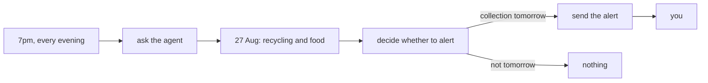

<!-- nav:top -->
[Home](../../../README.md) · [Contents](../../../README.md#contents) · Airflow track · Previous: [3. Run the skill in Airflow](../03-in-airflow/README.md) · Next: [5. Reduce cost while still getting the right answer](../05-cheaper-model/README.md)
<!-- /nav:top -->

# 4. Get timely alerts without running it yourself

*"Don't make me remember to ask."*

In chapter 3 the skill ran in Airflow, but only when you triggered it. In this chapter Airflow
runs it every evening at 7pm, and you only hear from it on the evening before a collection.



From the talk: the slide [From Agent Skill to Airflow Dag](https://alexhans.github.io/talks/airflow-summit/2026/it-works-now-what/#/from-agent-skill-to-airflow-dag).

## Decide what should happen

Running the Dag every evening changes what it has to do. When you were the one triggering it, 
you read the answer yourself and decided whether to put the bins out. When it runs by itself, it has to make that decision for you: on most evenings the next collection is days away and it should stay quiet, and on the evening before a collection it should tell you, but only once.

So you need it to run daily, and not just Wednesdays because you're not guaranteed that collections will be on Thursdays.  For example, in New Year's week the council may move the collection to a Saturday and by having it run daily, you're able to adjust by receiving the notification the day before.

Before changing the Dag, write down what should happen on each kind of evening and how you'll
check it. The two checks from chapter 3 stay, because the agent still has to read the right date
and bins from the website, and three new checks cover the decision making process on whether to alert or not and when:

| Run for | What should happen | Check | |
|---|---|---|---|
| 22 August, an ordinary week | it reads Thursday 27 August, recycling and food | `test_the_step_2_checks_still_pass[ordinary week]` | from chapter 3 |
| 27 December, New Year's week | it reads Saturday 2 January, recycling and food | `test_the_step_2_checks_still_pass[new year's week]` | from chapter 3 |
| 25 August, collection in two days | no alert | `test_stays_quiet_two_nights_before` | new |
| 26 August, collection tomorrow | one alert | `test_tells_me_the_night_before` | new |
| 26 August again, because it ran twice | still one alert | `test_never_tells_me_twice` | new |

These five were enough for me to trust it with my bins: the ordinary week, a holiday week where
the day changes, and the three evenings around a collection. For your own problem, ask which
situations matter, what the right outcome is in each, and how you'd know it's right without
checking by hand. Deciding what should happen in a new situation, and how to prove it, is a
skill worth getting good at, because it's what lets you hand work to an agent or put it on a
schedule and still change it safely afterwards.

## What changes in the Dag

[`dags/bin_day.py`](dags/bin_day.py) starts from chapter 3's Dag and changes three things. It
gets a schedule, 7pm every day. The prompt tells the agent what day it is and asks whether the
bins go out tonight, and the answer comes back as `BinDayAlert`: the next collection date and
the bins due, as before, plus whether to put them out tonight and a one-line message. 

The task `tell_me` now sends the alert. The changes look something like this:

```python
@dag(schedule="0 19 * * *", start_date=pendulum.datetime(2026, 8, 1, tz="Europe/London"), catchup=False)
def bin_day():
    ask_the_agent = AgentOperator(
        ...,
        prompt="... Today is {{ logical_date.strftime('%A %-d %B %Y') }}. Do I need to put the bins out tonight?",
        output_type=BinDayAlert,
    )


def act(answer: BinDayAlert, alerts_file: Path) -> str:
    if not answer.put_out_tonight:
        return f"Alert: none tonight. {answer.message}"
    if alerts.already_sent(answer.next_collection_date, alerts_file):
        return "Alert: already sent for this collection, not sending again."
    alerts.send(answer.next_collection_date, answer.message, alerts_file)
    return f"Alert: sent. {answer.message}"
```

`tell_me` calls `act` and prints the answer and the alert decision. 

It's important to note that we didn't give the agent the power to alert. Only to pass their information to the next task.  This is a good way to limit the blast radius of what an agent can do when they make a mistake.

> [!NOTE]
> The alert here is a line in a file, so the tutorial works without any accounts. To get it on
> your phone, have `tell_me` send the message instead, for example with Airflow's
> [Telegram provider](https://airflow.apache.org/docs/apache-airflow-providers-telegram/stable/index.html).

## Check it

The checks are in [`test_on_a_schedule.py`](test_on_a_schedule.py). The Dag now does two things:
the agent reads the website, and then plain Python decides whether to alert you and writes the
alert. The checks that have to wait for the AI agent will take a few seconds whereas the checks that 
are pure python will be a few milliseconds.

One of the python only tasks is `act` which holds the decision and the alert, so a check can pass it an answer you wrote yourself, as if the agent had said the bins go out tonight, and then read the alerts file to see what it did:

```python
def test_never_tells_me_twice(tmp_path):
    bin_day.act(answer(True), tmp_path / "alerts.log")
    assert bin_day.act(answer(True), tmp_path / "alerts.log").startswith("Alert: already sent")
```

The "slow" tests that need to run the agent carry the `agent` marker.  This can be used to filter which tests to run, like running `-m "not agent"` which can be used when mostly focusing on the non AI part of the workflow.

In the checks terminal from chapter 3, where `BINDAY_MODEL` is set, run them side by side with
`-n 4`, and the whole set takes about as long as the slowest one:

```bash
uv run --extra airflow pytest tracks/airflow/04-on-a-schedule -n 4 -v
```

You'll see something like this:

```
[gw1] [ 14%] PASSED tracks/airflow/04-on-a-schedule/test_on_a_schedule.py::test_sends_nothing_when_the_agent_says_not_tonight
[gw2] [ 28%] PASSED tracks/airflow/04-on-a-schedule/test_on_a_schedule.py::test_never_tells_me_twice
[gw0] [ 42%] PASSED tracks/airflow/04-on-a-schedule/test_on_a_schedule.py::test_sends_when_the_agent_says_tonight
[gw1] [ 57%] PASSED tracks/airflow/04-on-a-schedule/test_on_a_schedule.py::test_tells_me_the_night_before
[gw3] [ 71%] PASSED tracks/airflow/04-on-a-schedule/test_on_a_schedule.py::test_the_step_2_checks_still_pass[ordinary week]
[gw0] [ 85%] PASSED tracks/airflow/04-on-a-schedule/test_on_a_schedule.py::test_the_step_2_checks_still_pass[new year's week]
[gw2] [100%] PASSED tracks/airflow/04-on-a-schedule/test_on_a_schedule.py::test_stays_quiet_two_nights_before
7 passed in 57.19s
```

`[gw0]` to `[gw3]` are the four checks running at once.

In the talk, I showed the following slide for tips on faster loops, and we've done them all so far: 

A check that asks a second model to judge the answer is slow and costs money, so these compare
the answer with one you already know, with a plain assertion. The checks on `act` use Python
alone, which costs 0 LLM tokens and is very fast, meaning we can run them after every change.

Checks that don't depend on each other can run in parallel, which is what `-n 4` means: 
Run 4 in of these tests in parallel.

They can only run side by side if nothing they share can be changed by another check, so each
check gets its own alerts file, each test process gets its own Airflow home and database in a
temporary folder, and each test file starts its own copy of the council on a free port. The
council keeps no state, because the day is in the URL, so a check for 25 August and one for 26
August can run at the same time and each still sees its own day. Nothing carries over from one
run to the next, so you can run them again straight away.

<details>
<summary>How the agent checks run the Dag</summary>

As in chapter 3, they run the Dag with `dag.test()` for a chosen logical date, and look at what
the tasks returned and what was written to the alerts file:

```python
def test_tells_me_the_night_before(alerts_file):
    status = dagtest.run(bin_day.bin_day_dag, dt.date(2026, 8, 26))["tell_me"]
    assert status.startswith("Alert: sent.")
```

`dagtest.run` also prints a `[bin_day]` line with the model, the tokens and the seconds the
agent took; add `-s` to see it.

</details>


From the talk: the slide [Making the Loop Faster](https://alexhans.github.io/talks/airflow-summit/2026/it-works-now-what/#/making-the-loop-faster).

## Let your agent write it

This part is optional. In the talk, I made this change agentically too, by delegating it.
You can do the same here, because the checks already say what the Dag has to do. Delete
mine:

```bash
rm tracks/airflow/04-on-a-schedule/dags/bin_day.py
```

Then, from the repo folder, with `BINDAY_MODEL` set as before, start `claude` and paste:

```text
Write tracks/airflow/04-on-a-schedule/dags/bin_day.py so that the tests in tracks/airflow/04-on-a-schedule/test_on_a_schedule.py pass. Use the Common AI provider's AgentOperator with AgentSkillsToolset to run the bin-day skill, give the agent only a get and a post tool for the council's website, and send the alert with binday.alerts, once per collection. The agent decides whether the bins go out tonight. Don't change the tests or anything under src/. Run them with: uv run --extra airflow pytest tracks/airflow/04-on-a-schedule -n 4 -v
Keep going until they pass. Don't use git, and don't look at other chapters.
```

Approve the test runs it asks for. When it says they pass, run them yourself:

```bash
uv run --extra airflow pytest tracks/airflow/04-on-a-schedule -n 4 -v
```

Your agent's version will look different from mine, and the checks are what tell you whether
it does the job. To compare it with mine, and then to get mine back:

```bash
git diff tracks/airflow/04-on-a-schedule/dags/bin_day.py
git checkout -- tracks/airflow/04-on-a-schedule/dags/bin_day.py
```

<details>
<summary>What <code>git diff</code> and <code>git checkout --</code> do</summary>

`git diff <file>` shows how the file differs from the version in the repo, which is mine: lines
starting with `-` are mine, lines starting with `+` are your agent's. `git checkout -- <file>`
puts my version back.

</details>

## Run it every evening

Once the checks pass, let Airflow run it. In the Airflow terminal from chapter 3, stop Airflow
with `Ctrl-C` if it's still running, and start it again with this chapter's Dag:

```bash
uv run --extra airflow airflow-up 04-on-a-schedule
```

The Dag is still called `bin_day`, so it replaces chapter 3's in the list. Now that it has a
schedule, Airflow runs it at 7pm every day while Airflow is running, as long as the Dag is
unpaused, which the trigger form does for you. When you unpause it, Airflow also starts the run
for the most recent evening straight away. To see the night-before alert without waiting, start
a run for 26 August:

1. Open <http://localhost:8080> and click `bin_day`.
2. Press **Trigger**, set **Logical Date** to 26 August 2026, and press **Trigger**.
3. Open the **Runs** tab and click the run whose logical date is 26 August. When both tasks show
   **Success**, click `ask_the_agent`. Its **Logs** tab shows each tool call, then what the run
   took, something like this:

   ```
   Tool call: load_skill
   Tool call: post
   Tool call: post
   LLM run complete: model=global.anthropic.claude-opus-5-5, requests=4, tool_calls=3, input_tokens=13633, output_tokens=401, total_tokens=14034
   LLM run cost: $0.0107846 (USD, best-effort)
   ```

   Click a line that starts with ▶ to open it. The **Rendered Templates** tab shows the prompt
   with the date filled in.
4. Go back to the run and click `tell_me`. Its log shows the answer, then what it did about the
   alert:

   ```
   Next collection: Thursday 27 August 2026, blue recycling wheelie bin and food box.
   Alert: sent. Yes, put the blue recycling wheelie bin and the food box out tonight. They're collected tomorrow, Thursday 27 August 2026, and need to be out by 7am. The black rubbish wheelie bin is next, on Thursday 3 September 2026.
   ```

The alert is in `.airflow/alerts.log`, where everything Airflow writes stays, and `Ctrl-C`
stops it.


<details>
<summary>If you already have somewhere to run Dags</summary>

[`dags/bin_day.py`](dags/bin_day.py) is an ordinary Dag file, so you can put it in your Dags
folder. Where your tasks run, it also needs:

- The provider, with the extra for your model's provider, and this repo's small `binday`
  package, which the Dag imports:

  ```bash
  pip install "apache-airflow-providers-common-ai[skills,bedrock]>=1.0" /path/to/to-bin-or-not-to-bin
  ```

- Your skill: copy step 1's `sandbox/.claude/skills` folder somewhere your tasks can read, and
  set `BINDAY_SKILLS` to that folder.
- A connection called `binday_llm`. In the UI, under **Admin → Connections**, choose the type
  **Pydantic AI (AWS Bedrock)**, or **Pydantic AI** for other providers, and put the model in
  its **Model** field, and for Bedrock your AWS region too. Or set `AIRFLOW_CONN_BINDAY_LLM`,
  which is what `airflow-up` does.
- `BIN_SERVICE_URL`, the council's address, and `BINDAY_ALERTS`, the file to write alerts to,
  unless you change `tell_me` to send them somewhere else.

I tested it with Airflow 3.3; the provider supports Airflow 2.11 and later.

</details>

For it to work at 7pm, the made-up council has to be running then too; a real council's
website would always be there.

## If you want to keep this running

If you'd like your agents to run inside Dags like this one, here's what that gives you and where
you could run Airflow.

Airflow keeps a record of every run, for its day, with its own log of the tool calls, the tokens
and the cost, and you can run any day again from the UI. The agent can only use the tools the
Dag gives it, here two requests to one website. Airflow can retry a task that fails, and
`usage_limits` counts the model's requests across every retry together, so the retries stay
within the limit. The provider also offers steps this tutorial doesn't use: a person can approve
a tool call before it runs, and a durable run doesn't repeat the steps that had finished before
a retry. The coding agent track limits the agent too, with `--allowedTools`; the difference is
that here the limits are written in the Dag, next to the schedule and the alert.

`airflow standalone` is meant for trying Airflow out on one machine, as here. Airflow's docs
also describe running all its services with
[Docker Compose](https://airflow.apache.org/docs/apache-airflow/stable/howto/docker-compose/index.html),
and on Kubernetes with its [Helm chart](https://airflow.apache.org/docs/helm-chart/stable/index.html).
Managed services run it for you, among them [Astronomer](https://www.astronomer.io/),
[Amazon MWAA](https://aws.amazon.com/managed-workflows-for-apache-airflow/) and
[Google Cloud Composer](https://cloud.google.com/composer). Wherever it runs, the note "If you
already have somewhere to run Dags", above, lists what the Dag needs. To learn Airflow itself,
start with its [tutorial](https://airflow.apache.org/docs/apache-airflow/stable/tutorial/index.html),
and the [Common AI provider's docs](https://airflow.apache.org/docs/apache-airflow-providers-common-ai/stable/index.html)
cover its operators and toolsets.

## Going back to the cost

It now runs without you, but every evening's run still asks an AI model, which costs you a certain amount of tokens you can now observe.  Can that be optimized?

From the talk: the [video and transcript](https://alexhans.github.io/posts/talk.it-works-now-what.html).

---

<!-- nav:bottom -->
[Home](../../../README.md) · [Contents](../../../README.md#contents) · Airflow track · Previous: [3. Run the skill in Airflow](../03-in-airflow/README.md) · Next: [5. Reduce cost while still getting the right answer](../05-cheaper-model/README.md)
<!-- /nav:bottom -->
